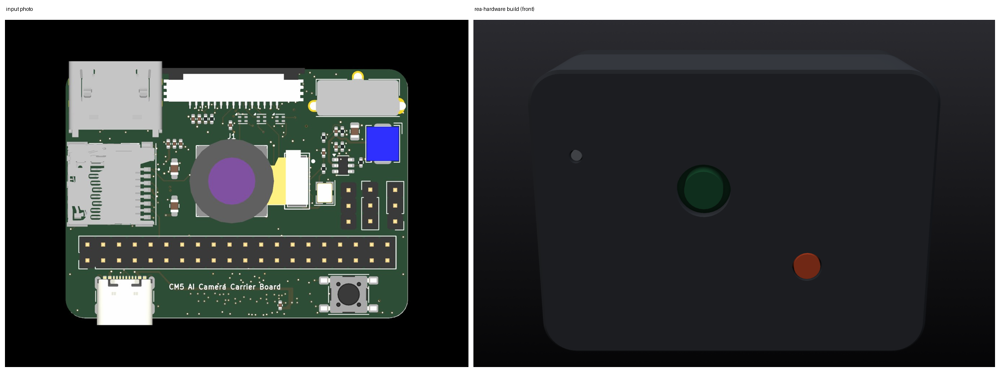
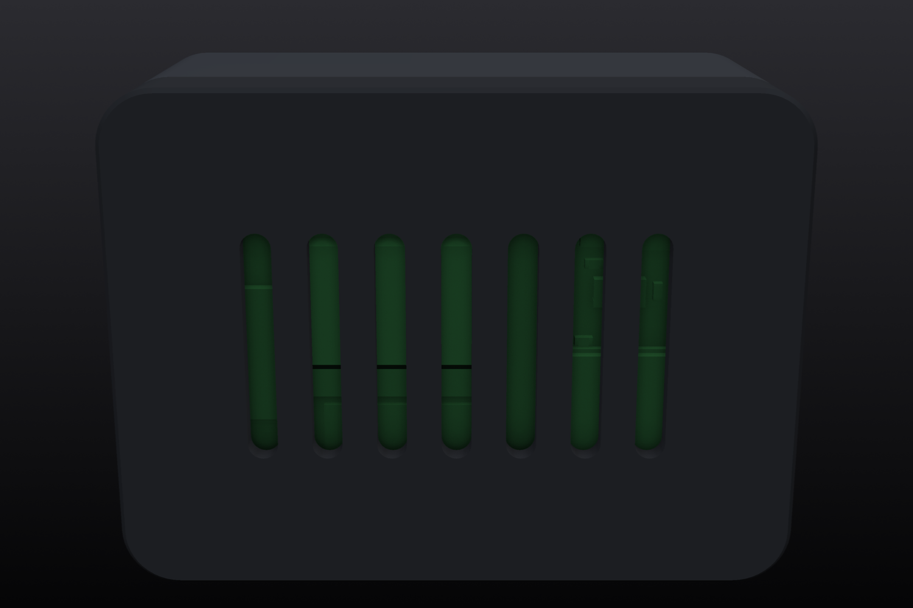
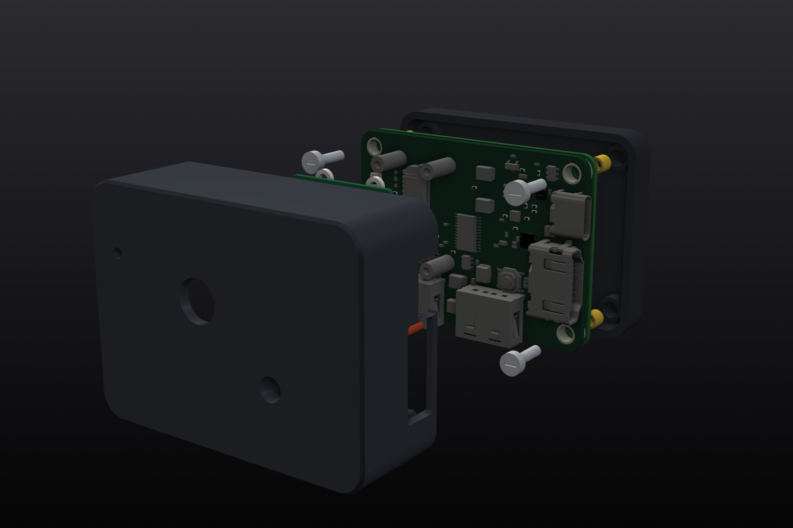

# Compact CM5 AI Camera

Compute Module 5 6-layer carrier board (55x40 mm) with 12MP AI Camera rotated 90 deg on 8 mm spacers, 50 mm fold-under 15-pin FFC on CAM0, USB-C PD/flashing, 2x USB-A 2.0, full-size HDMI, and snap-fit two-part FDM enclosure assembled by Lion Circuits

Generated from photos with [rea-hardware](https://github.com/CopperPilot/rea-hardware): KiCad schematic and PCB, enclosure, manufacturing files, and a gated test suite.



| Front | Rear | Exploded |
|---|---|---|
|  |  |  |

**Build video:** [docs/build-video.mp4](docs/build-video.mp4). Assembly order and insertion paths come from `rea/spec.yaml`, the same ones the collision tests check.

## Verification

Verdict **PASS**: 45 pass, 3 warn, 0 fail, 0 error, 0 skipped (generated 2026-11-04T23:04:28Z).

| Gate | Status | Detail |
|---|---|---|
| `spec.valid` Scope contract rea/spec.yaml is complete and consistent | PASS | must_match=8, blocks=5, placements=17, purchased=6, enclosure_parts=4, assembly_steps=11, requirements=8, prompt_chars=9 |
| `inputs.present` Input images and prompt are inside the workspace | PASS | images=6 |
| `brand.clean` No third-party brand marks in names, silkscreen, case or docs | PASS | hits=0 |
| `scope.board_fits` Every board fits inside the product's rounded outline, inside its wall | PASS | boards=1 |
| `sourcing.bom` Every placed part has a live, in-stock part at the fab's parts source | PASS | placed_symbols=81, unique_parts=37, lion_in_house=3, bom_cost_inr=22308.98 |
| `kicad.erc` Schematic ERC: 0 errors | PASS | errors=0, warnings=0 |
| `kicad.drc` PCB DRC with schematic parity + zone refill: 0/0/0 | WARN | errors=0, warnings=300, unconnected=0, parity=0 |
| `kicad.rules` Project rules are no looser than the fab profile; nothing silenced | PASS | fab=lioncircuits, copper_layers=6, tracks=1093, vias=179 |
| `board.contract` Board outline, holes and user-facing parts match the spec | PASS | width_mm=55.0, height_mm=40.0 |
| `kicad.models` Every placed footprint has a 3D model on disk | PASS | lcsc_models_misplaced=0, footprints=88, missing=0, unresolved=0, tampered=0 |
| `kicad.refs` Modules with a verified reference symbol use it (no hand-drawn pinouts) | PASS |  |
| `board.antenna` A module's printed antenna sits at the board edge with nothing around it | PASS |  |
| `kicad.parts` Every part sits on the footprint of that exact LCSC part, with its real 3D model (no placeholders) | WARN | parts=81, lcsc_codes=34, wrong_footprint=0, placeholders=0 |
| `board.cable_pinout` Both ends of each board-to-board cable carry the same signal on each wire | PASS |  |
| `board.stackup` The board's layer count, thickness and stackup match the spec and the fab | PASS | stack_mm:main=1.65 |
| `board.high_speed` Declared high-speed groups (DDR, MIPI, USB) are routed, length-matched and on target impedance | PASS |  |
| `board.user_ports` Every receptacle a person plugs into sits behind a case opening | PASS | user_receptacles:main=4 |
| `board.cc_protection` USB-C CC lines are not clamped to VBUS by a rail-referenced ESD array | PASS |  |
| `board.ground_pins` No ground pin is left unconnected | PASS |  |
| `board.pd_autonomous` A USB-PD charging input negotiates with no processor running | PASS |  |
| `board.connector_mating` Every connector mates from a known side, toward its cable, with a clear mating zone in its footprint | PASS | connectors:main=13 |
| `board.height_zones` Parts under an overhead part stay below the zone's height limit | PASS |  |
| `board.port_facing` Every user-facing port's connector opens towards its case opening (3D model) | PASS |  |
| `review.design` Datasheet-level design review (CopperPilot validate): no open P0 or P1 findings | PASS |  |
| `mech.meshes` Enclosure parts exist, are closed solids, and fit the envelope | PASS |  |
| `mech.openings` Every front/rear/edge feature has an opening in the shell, at its size | PASS | features_tested=7 |
| `mech.assembly` Draft assembly: no collisions seated or along insertion paths | PASS | parts=11, pairs=55, sweep_hits=0, min_clearance_mm=0.0 |
| `mech.dfm` Each enclosure part is manufacturable by its process (walls, build size) | PASS |  |
| `fidelity.dims` Key proportions (bezel, edge and centre thickness, overall size) match the reference | PASS | overall_width=59.0, overall_height=44.0, overall_depth=27.5, edge_thickness=27.5, center_thickness=27.5, corner_radius=5 |
| `integration.assembly` Final assembly with the KiCad-exported PCBA: no collisions | PASS | parts=11, pairs=55, sweep_hits=0, min_clearance_mm=0.0 |
| `integration.cables` Every cable joins two real connectors and fits its route in every pose | PASS | cables=1 |
| `integration.actuators` Every button, crown, dial or sensor window physically works its part | PASS |  |
| `integration.ports` Every port opening has its connector right behind it (a plug can mate) | PASS | ports_tested=4 |
| `integration.mating` Every connector faces what mates with it, and every mounting hole sits on a boss (checked on the 3D models) | PASS | checked=9 |
| `integration.band` A wrist band closes round the wrist, its sensor faces the wrist, and a slide-on charger meets its contacts | PASS |  |
| `integration.retention` Every assembled part is held in place by something real (snap, clip, screw, adhesive, press fit, captured) | PASS |  |
| `integration.rf` A radio's antenna is not sealed inside metal (an RF window exists) | PASS |  |
| `integration.battery_fill` In a laptop- or tablet-sized product the battery fills the free space at its height | PASS |  |
| `integration.camera_view` Every camera sees out: its whole field of view clears the case | PASS |  |
| `fab.package` Gerbers, drill, BOM and CPL exist and agree with the PCB | WARN | bom_lines=34, placements=81, gerber_files=18 |
| `video.build` 3D build video exists and actually shows motion | PASS | seconds=48.0, frames=1440, moving_fraction=0.95 |
| `tests.integrity` Generated test suite is the rea template, unmodified | PASS |  |
| `fidelity.judge` Independent visual judge: renders match the reference photos | PASS | score=9.0, features=8, requirements_score=9 |
| `spec.locked` Scope contract unchanged since scope (or changes justified) | PASS | changed_keys=0 |
| `system.valid` System spec: modules, interfaces, power tree, assembly order are consistent | PASS |  |
| `system.modules` Every built module passes all of its own gates | PASS |  |
| `system.assembly` Modules do not collide with each other, seated or along system insertion paths | PASS |  |
| `system.cables` Every inter-module cable plugs into a real port on each module and is long enough | PASS |  |

Run them yourself: `pip install rea-hardware[video]` then `make test` (one pytest case per gate).

## Bill of materials

33 lines; full file: `fab/rpi-ai-cam-lc-bom.csv`.

| Designators | Part | LCSC |
|---|---|---|
| C1 | 2.2uF |  |
| C8,C10,C11,C12,C34 | 1uF |  |
| C2,C3,C19 | 22uF |  |
| C4,C5,C6,C7,C20,C21,C25,C33 | 100nF |  |
| C22,C23,C24 | 4.7nF |  |
| C26,C27,C28,C29,C30,C31 | 100uF |  |
| C9,C32 | 2.2uF |  |
| D1,D2,D3 | USBLC6-2SC6 |  |
| D5,D6,D7,D9,D10,D11 | TPD1E05U06DPYR |  |
| D12 | BAT54S |  |
| D4 | TVS2200DRVR |  |
| D8 | PESD3V3S1BLYL |  |
| J1 | USB4105-GF-A |  |
| J2,J3 | 629104190121 |  |
| J4 | 10029449-111RLF |  |
| J5 | SFW15R-1STE1LF |  |
| J6,J7 | 10164227-1001A1RLF |  |
| R1,R2,R16 | 43k |  |
| R6,R7,R10,R11 | 22k |  |
| R12 | 390k |  |
| R13 | 49.9k |  |
| R14 | 107k |  |
| R8,R9,R15,R20 | 100k |  |
| R5,R17,R18 | 1.33k |  |
| R19 | 6.8k |  |
| SP1,SP2,SP3,SP4 | 9774080243R |  |
| SP5,SP6,SP7,SP8 | 9774015960R |  |
| SW1 | PTS526SM15SMTR2LFS |  |
| SW2 | B3U-1000P |  |
| U1 | TPD12S016PWR |  |
| U2,U3 | AP2553W6-7 |  |
| U4,U5 | TPS259470ARPWR |  |
| U6 | TPD6S300ARUKR |  |

Off-board parts:

- **cm5**: Compute Module 5 with eMMC (any eMMC variant such as CM5104016 or CM5104032; bought outside Lion Circuits, excluded from the Lion PCBA BOM, and pressed into J6/J7 at final assembly)  (https://www.raspberrypi.com/products/compute-module-5/)
- **ai_camera**: 12 MP IMX500 Intelligent Vision Camera Module SC1174 (https://www.lioncircuits.com/parts)
- **m2_washers**: Eight flat M2 x 0.5 mm nylon washers (two per spacer, 1.0 mm stack height, OD 4.0 mm, ID 2.2 mm) placed atop SP1..SP4  (https://www.mcmaster.com/90295A080/)
- **camera_m2_screws**: Four Essentra M2 x 4 mm pan-head nylon screws fastening ai_camera through m2_washers into SP1..SP4 50M020040N003 (https://www.lioncircuits.com/parts)
- **m25_inserts**: Four M2.5 x 3.5 mm brass heat-set threaded inserts (OD 3.5 mm) pressed into back_shell corner bosses  (https://www.mcmaster.com/94180A321/)
- **m25_screws**: Four M2.5 x 8 mm pan-head machine screws passing from carrier top through SP5..SP8 and the module into m25_inserts  (https://www.mcmaster.com/92000A065/)

## Manufacture

Fab profile: `lioncircuits`, 6 layers, 1.6 mm. Upload `fab/*-gerbers.zip`, then the BOM and CPL CSVs for assembly. Print the enclosure STLs in `case/out/` (fdm).

## Rebuild

```
make all      # case, fab, renders, video, tests, README
make test     # gates only
```

## Scope

- In scope: camera lens window, power button, boot pinhole, USB-C power and flashing port, HDMI port, USB 2.0 Type-A host port 0, USB 2.0 Type-A host port 1, rear CM5 cooling vents
- Out of scope: tripod mount thread, external Wi-Fi u.FL antenna, SD card slot, 40-pin GPIO expansion header
- Decision: Power path and current budget from USB-C J1? -> J1 VBUS connects to upstream net VBUS_IN (protected by TI TVS2200DRVR 22 V 1.12 kW flat-clamp unidirectional WSON-6 surge TVS D4 with LCSC C523793, VRWM=22 V tolerating continuous 20 V +/- 5% USB-C PD overvoltage faults without breakdown, VBR=24.6-27.6 V at 1 mA, VCLAMP=27.2 V typ / 27.7 V max at 24 A 8/20 us and 27.6 V typ / 28.0 V max at 40 A 8/20 us <= +28 V U4/U5 abs max, and VF=-0.5 V typ clamping negative inductive transient ringing on reversible USB-C J1, and decoupled by C1=2.2 uF 50 V X7R 0805 Samsung CL21B225KBYNNWE + C4=100 nF 50 V X7R 0402 = 2.3 uF nominal / 2.53 uF max at +10% tolerance <= 10 uF USB Type-C cSink limit, both rated at 50 V >= 1.79x D4's 28.0 V maximum clamping voltage) and feeds two parallel TI TPS259470ARPWR active-current-limiting ideal-diode OVP eFuses (U4 primary, U5 secondary in TI Datasheet Figure 8-18 active-standby parallel configuration, combined R_ON(typ) = 14.15 mOhm at 25 C / 21.0 mOhm max at 85 C, with wide F.Cu copper polygons, a dedicated 1 oz In3.Cu VBUS_IN plane, 8 VBUS_IN vias, mirror-symmetric 9-via U4.6/U5.6 output arrays, a 1 oz In3.Cu +5V plane, and 5 parallel +5V vias with 0.50 mm B.Cu bus bars at J6 pads 77-87 -> ~2 mOhm total PCB copper+via resistance and ~48 mV typ / ~110 mV max carrier drop at 3.0 A) driving downstream +5V to CM5 +5V pins (J6 pads 77, 79, 81, 83, 85, 87), U2/U3 (AP2553W6-7), and U1 (TPD12S016PWR); CM5 internal PMIC generates +3V3 (feeding J5 camera and GPIO_VREF) and +1V8. U4 soft-starts via C22=4.7 nF (0.43 V/ms, ~11.7 ms ramp) while U4 AUXOFF (U4.3) holds U5 EN/UVLO (U5.1, net VBUS_U5_EN) low until U4's HFET gate reaches full overdrive, after which R15=100 kOhm (referenced to upstream VBUS_IN) and R16=43 kOhm (GND) bias U5 EN/UVLO to 1.50 V at 5.0 V (setting V_IN(UVLO_R)=3.99 V and V_IN(UVLO_F)=3.66 V without sensitivity to downstream +5V droop), and open-drain U5.3 (AUXOFF), U4.4 (~{FLT}), and U5.4 (~{FLT}) on net VBUS_AUXOFF feed CM5 PMIC_Enable (J6 pad 99, net PMIC_ENABLE, pulled up to +5V via CM5's internal 100 kOhm resistor) through R19=6.8 kOhm (RC0402FR-076K8L), C32=2.2 uF (25 V X7R 0603 GRM188Z71E225KE43D to GND, C_eff >= 1.85 uF typ / 1.68 uF min at 5 V bias and -10% tolerance, setting tau_fall = 14.0 ms nominal / 10.7 ms worst-case derated > 2.7x t_ITIMER=3.94 ms so a 3.94 ms low pulse keeps PMIC_ENABLE >= 3.58 V >> 2.0 V VIH_min, and V_LOW=0.37 V < 0.40 V), external pull-up R5=1.33 kOhm (RC0402FR-071K33L from +5V to VBUS_AUXOFF), and dual series Schottky diode D12 (Rectron BAT54S, LCSC C408389: Diode 1 Pin 1->3 from VBUS_AUXOFF to PMIC_ENABLE providing fast charge tau_rise = 2.88 ms nominal / 2.42 ms effective so PMIC_ENABLE slews 0.4 V->2.0 V in 1.12 ms and recharges 4.4x faster than tau_fall without ratcheting while reverse-biasing when VBUS_AUXOFF is low, and Diode 2 Pin 3->2 from PMIC_ENABLE to +5V immediately discharging C32 into +5V so J6.99 is never back-driven on rapid +5V collapse) per TI Figure 8-18 ('To downstream enable'). Shared divider R12=390 kOhm / R13=49.9 kOhm (RC0402FR-0749K9L, LCSC C137969) / R14=107 kOhm (RC0402FR-07107KL, LCSC C138070) sets UVLO_R=4.18 V and OVLO_R=6.13 V typ (5.83 V min > 5.50 V USB-PD vSafe5V max, 6.45 V max; OVLO_F=5.62 V typ / 5.33 V min, disconnecting >6.1 V and 20 V USB-C faults), R17=R18=1.33 kOhm (RC0402FR-071K33L, LCSC C276261, >=750 Ohm UL2367) set ILIM(typ)=2.504 A per eFuse (5.00 A combined <= J1 5.0 A VBUS contact rating, ILIM(min)=2.281 A / 4.56 A combined, ILIM(max)=2.731 A) so neither eFuse reaches ILIM(min) under worst-case 60%/40% passive R_ON+PCB sharing up to 2.281 A / 0.60 = 3.80 A (> 3.62 A worst-case system fault load / 3.26 A nominal full load) and active current-limit regulation equalizes sharing up to 5.0 A, and C23=C24=4.7 nF on U4.10 and U5.10 (ITIMER) set steady-state transient overcurrent blanking t_ITIMER=3.94 ms after start-up. U2/U3 current limits use R1=R2=43 kOhm (0.56 A min / 0.615 A typ / 0.68 A max per USB-A port), USB0_VBUS and USB1_VBUS each have 222 uF nominal / ~207.5 uF effective low-ESR capacitance (two 100 uF 10 V 70 mOhm Kemet T520B107M010ATE070 KO-CAP polymer tantalum capacitors C26+C27 on USB0_VBUS and C28+C29 on USB1_VBUS with zero DC-bias derating, plus 22 uF 10 V X5R 0603 MLCC C2/C3 providing ~7.5 uF effective HF bypass at 5 V; >= 167.5 uF worst-case at -20% tolerance >= 120 uF per USB 2.0 Section 7.2.4.1 Table 7-7, charging to 5 V in 1.69 ms typ / 1.85 ms at 0.56 A ILIM_min << 4-15 ms AP2553W6-7 t_Blank without asserting FAULT_N) backed by 205.2 uF nominal / ~203.5 uF effective upstream +5V bulk capacitance (C30=100 uF and C31=100 uF T520B107M010ATE070 polymer tantalum + C9=2.2 uF + C10..C12=3x1 uF), USB_VBUS_EN (U2.3) is strapped low at boot with R10=22 kOhm, and U3.3 (USB1_VBUS_EN) is controlled independently by CM5 GPIO26 (J6 pad 24) with 22 kOhm off-state pull-down R11 to GND and zero capacitive loading (C21=100 nF reassigned to +5V HF bypass) so USB-A port 1 defaults OFF in hardware during reset and boot (guaranteeing <= 2.935 A <= 3.0 A on 3.0 A non-PD sources) until software enables GPIO26, D1 (USBLC6-2SC6 on USB2_P/N) has pin 5 (VBUS_D1_CLAMP) locally decoupled to GND by C25=100 nF and DC-biased from +5V through R20=100 kOhm (keeping D1's upper steering diodes reverse-biased at 5 V for 2.5 pF typ capacitance without peak-rectifying 3.3 V Full-Speed edges while limiting unpowered clamp current to <33 uA and isolating from 20 V on VBUS_IN), U6 (TI TPD6S300ARUKR, LCSC C2876380, WQFN-20) provides 24 V-tolerant series OVP FETs (V_OVP=6.0 V typ / 6.2 V max, 290 mOhm R_ON, 70 ns response), IEC 61000-4-2 ESD protection, and dead-battery 5.1 kOhm Rd pull-downs (C_CC1/RPD_G1 pins 4/7 on C_CC1 from J1.A5, C_CC2/RPD_G2 pins 5/6 on C_CC2 from J1.B5, VBIAS pin 3 decoupled by C33=100 nF 50 V X7R 0402 to GND, VPWR pin 10 powered from +3V3 with C34=1 uF 25 V X5R 0402 bypass, and ~{FLT} pin 9 pulled up to +3V3 via R9=100 kOhm) between J1.A5/B5 and protected system-side CC1/CC2 (U6 pins 12/11 to J6.94/96 and secondary 5.5 V unidirectional TPD1E05U06DPYR ESD clamps D5/D6 to GND), D7 uses 5.5 V unidirectional TPD1E05U06DPYR on PWR_BUT (5 V CM5 pull-up domain), and D8 uses 3.3 V PESD3V3S1BLYL on nRPIBOOT. On U1 (TPD12S016PWR), LS_OE (pin 5) is tied to GND and CT_HPD (pin 12) to +3V3 so the 55 mA HDMI0_5V load switch and HPD buffer remain enabled while the internal DDC/CEC level shifters are disabled; CEC_A/SCL_A/SDA_A (pins 1-3) are tied to +3V3 (<=3.6 V), C8=1 uF (GRM155R61E105KE11J) provides the TI-recommended 1 uF output reservoir on U1.13 (5V_OUT), CEC_B/SCL_B/SDA_B (pins 7-9) are left open (no-connect) so neither U1's internal 27 kOhm CEC_B pull-up nor its 1.75 kOhm DDC pull-ups contend with the CM5, and CM5's 5 V-tolerant fail-safe HDMI0_SCL/HDMI0_SDA (internal 1.8 kOhm pull-ups to +5V) and HDMI0_CEC (internal 27 kOhm pull-up to +3V3) drive J4 pins 15, 16, and 13 directly with local ultra-low-capacitance (0.42 pF typ) 5.5 V unidirectional TPD1E05U06DPYR ESD TVS diodes D9, D10, and D11 to GND at J4. (Current budget: CM5 ~1.5-2.0 A + AI Camera ~0.20 A reflected to +5V (~0.25 A at +3V3) + HDMI 5V (0.055 A) + 2x USB-A 2.0 host ports (2 x 0.50 A nominal, 0.615 A typical / 0.68 A max limit per port via 43 kOhm R_ILIM on AP2553W6-7). Full simultaneous dual-USB-A load (3.26-3.62 A worst-case) operates within a 5 V / 5 A USB-PD contract negotiated natively by CM5 over CC1/CC2 (supported by U4 || U5 with R17=R18=1.33 kOhm giving ILIM(typ)=2.50 A per eFuse / 5.0 A combined <= J1 5.0 A VBUS contact rating and ILIM(min)=2.28 A supporting >=3.80 A > 3.62 A under worst-case 60%/40% passive R_ON+PCB sharing), while on a 5 V / 3.0 A non-PD source CM5 software can independently disable USB-A port 1 (J3/U3) by driving GPIO26 (J6 pad 24, USB1_VBUS_EN) low so hardware-limited peak current stays <=2.935 A <= 3.0 A. Isolating downstream +5V behind the soft-started parallel TPS259470ARPWR pair (with R15 referenced to VBUS_IN and open-drain U5.3 AUXOFF + U4.4/U5.4 ~{FLT} shaped by R5=1.33k + D12 BAT54S + R19=6.8k + C32=2.2 uF X7R to J6.99 PMIC_Enable per TI Figure 8-18) keeps unswitched cSink at J1 to 2.3 uF nominal (<= 10 uF USB Type-C limit), holds the CM5 PMIC in reset during soft-start and persistent >3.94 ms faults without false resets during <3.94 ms transient current limiting, limits carrier voltage drop at 3.0 A to ~48 mV typ / ~110 mV max (within the 0.25 V total budget to 4.75 V), blocks reverse current from +5V to VBUS_IN, and disconnects >6.1 V and 20 V USB-C overvoltage faults (with OVLO_R,min=5.83 V > 5.50 V USB-PD vSafe5V max) behind TI TVS2200DRVR 22 V flat-clamp unidirectional surge TVS D4.)
- Decision: Flashing and boot-mode path for CM5? -> USB2_P/USB2_N (J7 pads 5/3, CM5 pins 105/103) wired directly to USB-C J1 D+/D- with USB_OTG_ID (J7 pad 1, CM5 pin 101) left unconnected so CM5 internal pull-up selects USB Device / rpiboot mode; SW2 (Omron B3U-1000P) pulls nRPIBOOT (J6 pad 93, CM5 pin 93) directly to GND when held with a paperclip at power-up. (Per CM5 Datasheet Section 3.4, leaving USB_OTG_ID unconnected selects USB Device mode for rpiboot flashing and USB gadget networking (whereas grounding USB_OTG_ID forces Host mode). Hardware switch SW2 holds nRPIBOOT at 0 V before USB-C VBUS is applied, guaranteeing nRPIBOOT is low well within the 2 ms window after 5 V rises. User USB-A ports J2/J3 use RP1 host pairs USB3-0-D_P/N and USB3-1-D_P/N, leaving the OTG pair dedicated to J1.)
- Decision: How are the 6-layer stack-up, layer order, and controlled-impedance traces realized on Lion Circuits? -> Upgrade the board from 4 layers to 6 layers, 1.6 mm, on Lion Circuits' published 6-layer 1.6 mm Custom-tier stack-up with impedance control: L1 F.Cu (signal, 0.035 mm) / 0.12 mm 2116*1 prepreg / L2 In1.Cu (unbroken GND plane, 0.035 mm) / 0.36 mm NP-140 core / L3 In2.Cu (slow signals, 0.035 mm) / 0.48 mm 2116*4 prepreg / L4 In3.Cu (+5V and +3V3 power planes, 0.035 mm) / 0.36 mm NP-140 core / L5 In4.Cu (unbroken GND plane, 0.035 mm) / 0.12 mm 2116*1 prepreg / L6 B.Cu (signal, 0.035 mm), with er=4.1. Update net classes for the 0.12 mm outer prepregs: Diff100 (100 ohm HDMI0 TMDS and 2-lane MIPI0 CSI-2) uses 0.1524 mm (6.0 mil) width and 0.18 mm (7.1 mil) gap (99.9 ohm differential; existing 0.1524 mm routes with 0.25-0.55 mm gap give 105.4-112.1 ohm, within 100 ohm +/- 15%); Diff90 (90 ohm USB2 OTG and USB3_0/USB3_1 USB 2.0 pairs) uses 0.175 mm (6.9 mil) width and 0.1524 mm (6.0 mil) gap (89.8 ohm differential; or 0.20 mm width if preserving 0.45-0.53 mm gap segments -> 95.3-95.8 ohm, within 90 ohm +/- 15%). Route the slow nets (HDMI0_HOTPLUG, HDMI0_CEC, HDMI0_SCL, HDMI0_SDA, CC1, CC2, CAM_GPIO0, CAM_GPIO1, SCL0, SDA0, PWR_BUT, UART0_RXD and their pull-ups) on In2.Cu while keeping existing component placement where the camera changes allow and preserving valid high-speed routes. (Owner directive (3 Nov): on 4 layers only F.Cu and B.Cu carried signals while B.Cu was congested by J6/J7 and SP5..SP8, leaving 12 slow nets unrouted across three sessions. The 6-layer stack-up dedicates In1.Cu and In4.Cu as unbroken GND reference planes immediately adjacent to F.Cu and B.Cu so every high-speed differential pair runs next to an unbroken GND plane and never crosses a split on In3.Cu, while In2.Cu provides a clean inner routing plane for all slow control and I2C/CEC/CC signals.)
- Decision: What are the keepout, requirement R1, and Lion Circuits fab/BOM/CPL updates for the 6-layer revision? -> Expand the 8x15 mm CM5 antenna keepout (cm5_wifi_antenna, rect_mm [0.0, 14.0, 8.0, 29.0]) to all six copper layers [F.Cu, In1.Cu, In2.Cu, In3.Cu, In4.Cu, B.Cu], drop the old camera_socket_keepout 0 mm rule area, and update requirement R1, the fab package, and Lion BOM/CPL notes to 6 layers. (Matches the CM5 datasheet requirement for zero copper on any layer beneath the PCB antenna and aligns R1 and the Lion Circuits 6-layer Custom-tier fabrication/assembly package with the owner's 3 Nov specification.)
- Decision: How are the AI Camera orientation, mounting stack, height zones, and SW1 placement updated? -> Use rea_hardware.parts.ai_camera((20.431, -15.7), z_underside=10.6, rot_deg=90) so the camera is rotated 90 deg CCW (cable leaving through +x right edge at x=32.362 mm, board spanning x=8.5..32.362 mm clear of the x=0..8 mm antenna keepout, portrait image rotated in software). Mount the camera on four Wurth 9774080243R M2x8.0 mm SMT spacers (SP1..SP4 at (10.5, 5.2), (23.0, 5.2), (10.5, 26.2), (23.0, 26.2)) plus two 0.5 mm flat M2 washers per spacer (1.0 mm washer stack, Z=9.6..10.6 mm), placing the camera underside at Z=10.6 mm (9.0 mm above F.Cu) and camera ribbon centre at Z=9.225 mm (6.30 mm >= 6.0 mm above J5's slot centre at Z=2.925 mm). Fasten with four Essentra 50M020040N003 M2x4.0 mm nylon screws (4.0 mm shank - 1.12 mm camera PCB - 1.00 mm washers = 1.88 mm >= 1.8 mm thread engagement in SP1..SP4). Update board.height_zones from .socket_rect [26.652, 5.895, 32.362, 25.505] to max_height_mm=5.75 mm ((10.6 - 2.75) - 1.6 - 0.5) and .outline_rect [8.5, 3.2, 32.362, 28.2] to max_height_mm=6.65 mm ((10.6 - 1.85) - 1.6 - 0.5), allowing SP1..SP4 and J5. Move SW1 and its front_shell plunger F2 from (38.5, 24.0) to (38.5, 27.6) (front view [40.5, 29.6]) so both sit outside the y=7.7..23.7 mm 16 mm FFC U-turn band. (Owner directive (3 Nov) from AI Camera product brief p.4: rotating 90 deg and folding the ribbon under on 8 mm spacers + two washers provides >=6.0 mm vertical separation between the upper (Z=9.225 mm) and lower (Z=2.925 mm) ribbon levels for a >=3.0 mm radius U-turn while keeping >=1.8 mm screw thread engagement.)
- Decision: What are the J5 connector, CM5 camera port 0 pinout, I2C pull-up configuration, and 50 mm FFC route? -> Replace J5 with Amphenol SFW15R-1STE1LF (15-pin 1.0 mm right-angle bottom-contact ZIF FFC socket, LCSC C3168538, Lion stock) placed under the camera at board (13.5, 15.7) with rot_deg=90 (mouth facing +x towards the U-turn, long axis along y) and pads numbered 1..15 from the world +y end (board y=8.7 mm) to the world -y end (board y=22.7 mm) so J5 pin 1 aligns with camera J_CAM pin 1 at Y=-8.7 mm. Wire J5 to CM5 camera port 0 (CAM/DISP 0): 1=GND, 2=MIPI0_D0_N (J7 pad 15, CM5 pin 115), 3=MIPI0_D0_P (J7 pad 17, CM5 pin 117), 4=GND, 5=MIPI0_D1_N (J7 pad 21, CM5 pin 121), 6=MIPI0_D1_P (J7 pad 23, CM5 pin 123), 7=GND, 8=MIPI0_C_N (J7 pad 27, CM5 pin 127), 9=MIPI0_C_P (J7 pad 29, CM5 pin 129), 10=GND, 11=CAM_GPIO0 (J6 pad 97, CM5 pin 97, camera power enable with 100 kOhm pull-down R8), 12=CAM_GPIO1 (J6 pad 100, CM5 pin 100, no external pull-down so CM5 internal 15 kOhm pull-up to +3V3 and boot-time active-low nEXTRST drive are uncontested), 13=SCL0 (J6 pad 80, CM5 pin 80), 14=SDA0 (J6 pad 82, CM5 pin 82), 15=+3V3; mounting tabs 16/17=GND. Do not fit external pull-up resistors R3/R4 on SCL0/SDA0 or pull-down R9 on CAM_GPIO1 because the CM5 module (internal 1.8 kOhm pull-ups on SCL0/SDA0 and internal 15 kOhm pull-up on CAM_GPIO1 to +3V3, verified against CM5 datasheet and CM5 IO Board rev 2 schematic) and the AI Camera provide onboard termination. Connect J5 to J_CAM with Wurth 686615050001 (15-way, 1.0 mm, 50 mm +/- 3 mm, same-side contacts, 16 mm wide, 10 mm stiffeners, 0.3 mm thick, Lion stock) with stiff_end_mm=6.0, contacts=same, and J5 contacts_face=[0,0,-1], routed straight out of each socket past the stiffeners and around a >=3.37 mm radius 180 deg U-turn keeping outer x=43.73 mm <= 44 mm clear of D1/D4-D6/C1/C4, J1, and J4. (Fixes the previous port 1 / port 0 bus mismatch so stock Raspberry Pi OS with dtoverlay=imx500,cam0 discovers the IMX500 on I2C0 and receives 2-lane CSI-2 video on MIPI0, while the 180 deg U-turn flips the same-side ribbon's contact face from up (+Z at J_CAM) to down (-Z at bottom-contact J5) with pin 1 on the world +y edge at both ends.)
- Decision: How are the case depth, FOV window, assembly sequence, and continuity checks updated? -> Grow the front_shell by 5.5 mm to Z=+20.0 mm (total envelope depth 27.5 mm from Z=-7.5 mm to Z=+20.0 mm) to enclose the camera lens front at Z=+19.75 mm, center F1 at front-view [25.0, 17.7] (board (23.0, 15.7)) sized to clear the full 66.3 x 52.3 deg +/- 3 deg FOV cone (horizontal along y), and leave smooth internal room for the U-turn up to x=44 mm. Document in assembly notes and rea/observation.md: (1) plug the 50 mm FFC into the camera first, close J5's latch with the camera lifted, then fold the U-turn and screw the camera down; (2) before first power, verify with a multimeter that J5 pin 15 (+3V3) has continuity to camera pin 15 and J5 pin 1 (GND) has continuity to camera pin 1; (3) verify the camera sits flat on all four spacers without rocking; (4) configure software with dtparam=ant1 and dtoverlay=imx500,cam0. (Captures all owner-mandated mechanical envelope, optical FOV, assembly order, and pre-power electrical verification requirements.)

Not affiliated with or endorsed by the maker of any product shown in the reference photos.
